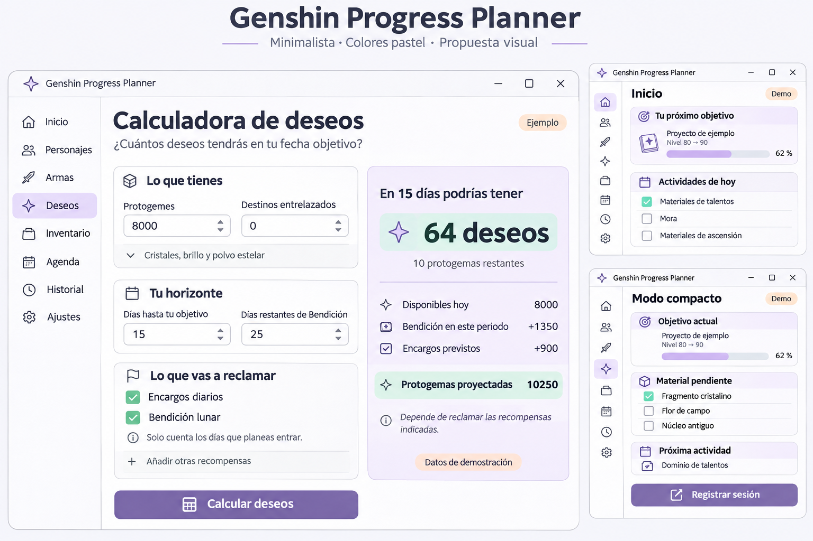
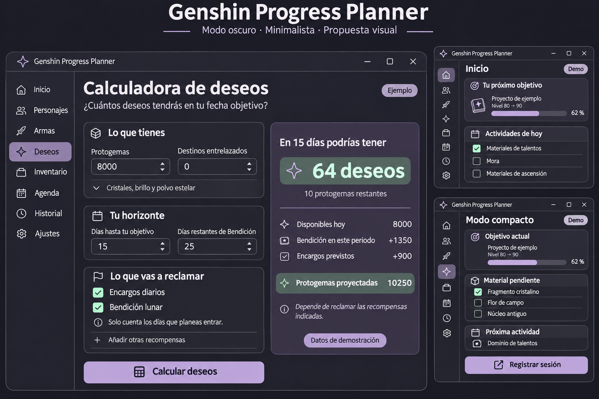

# Diseño minimalista pastel y modo oscuro

La v2 sustituye la dirección visual de la v1 por solicitud del usuario. Generada con la herramienta integrada de imágenes el 2026-11-15. Las imágenes son conceptos de fases posteriores: el formulario de Deseos y las cifras son demostrativos; el motor no está implementado en Fase 1.

En la aplicación base se implementan la paleta pastel, la alternativa oscura, la opción Sistema, su persistencia y el acceso a la sección Deseos. La vista completa se implementará según las fases.

## Prompt de la propuesta clara

Use case: ui-mockup. Redesign the previous Genshin Progress Planner mockup into a MUCH more minimal, intuitive, light pastel native Windows productivity app. Input image 1 is the earlier design to supersede: keep app concept, but REMOVE all navy backgrounds, gold frames, fantasy landscape art, ornamental logo, visual clutter and textures. Input image 2 is a FUNCTIONAL reference only for the wish calculator fields; do not copy its styling. Create a crisp professional landscape design board, large readable high fidelity UI, with a main large wishes calculator window taking roughly 75% of width and two smaller preview panels on the right (Dashboard above, compact mode below).
Board header "Genshin Progress Planner" subtitle "Minimalista · Colores pastel · Propuesta visual". Background warm off-white #F7F8FC. App panels pure white, subtle cool gray hairline separators, almost no shadows, generous spacing, soft 14px rounded corners. Lavender #EAE5FA for selection, dusty purple #74639B for primary buttons and dark slate #303446 readable text, soft mint #DFF2E8 for positive summary, pale peach #FBEADF accent. Elegant restrained geometric sans serif, NOT a decorative fantasy app. Simple consistent monoline icons, no game character art, no copyrighted logos. Native Windows title bar, no browser frame.
Main window title "Calculadora de deseos". Slim left sidebar with small original four-point star symbol, navigation "Inicio", "Personajes", "Armas", "Deseos", "Inventario", "Agenda", "Historial", "Ajustes". Deseos selected in lavender pill. Header under title "¿Cuántos deseos tendrás en tu fecha objetivo?" small badge "Ejemplo".
Content two columns: left form around 60%, right clear result around 40%. Form is grouped in THREE simple stacked cards:
1 "Lo que tienes" with compact two-column labeled number inputs "Protogemas" value "8000", "Destinos entrelazados" value "0"; secondary expandable row "Cristales, brillo y polvo estelar".
2 "Tu horizonte" with "Días hasta tu objetivo" input "15" and "Días restantes de Bendición" input "25".
3 "Lo que vas a reclamar" with mint checked toggle "Encargos diarios" and checked toggle "Bendición lunar"; subtle helper "Solo cuenta los días que planeas entrar." collapsed row "+ Añadir otras recompensas".
Primary button "Calcular deseos".
Result panel soft lavender, label "En 15 días podrías tener", big type "64 deseos", secondary "10 protogemas restantes". Simple separator and breakdown rows "Disponibles hoy" "8000", "Bendición en este periodo" "+1350", "Encargos previstos" "+900", bold total "Protogemas proyectadas" "10250". Plain note below "Depende de reclamar las recompensas indicadas." Badge "Datos de demostración". Keep result arithmetic exactly as specified, do not add unrelated rates, gambling odds or purchase buttons. Bendición 25 is remaining duration but only 15 days are counted, never 25 full days.
Right top preview labeled "Inicio" has white sidebar and sparse cards "Tu próximo objetivo", "Actividades de hoy", gold replaced by pastel lavender/mint; no invented real character names, small badge "Demo".
Right bottom preview labeled "Modo compacto" narrow white panel with "Objetivo actual", simple progress bar, 3 checkboxes "Material pendiente", small "Próxima actividad", single lavender action "Registrar sesión", badge "Demo".
Overall must feel quiet, spacious, accessible and easy to use. Prioritize legibility of the main calculator. All labels in Spanish. This is conceptual design, not a finished software screenshot.

## Prompt de la variante oscura

Use case: ui-mockup, style-transfer edit. Create the DARK MODE counterpart of this exact pastel Genshin Progress Planner design board. Preserve all layout, all calculator data and Spanish labels, every panel position, the "64 deseos" result, the "10 protogemas restantes", 8000 + 1350 + 900 = 10250, the Dashboard preview and compact-mode preview. Change only the color theme to a restrained comfortable dark appearance with matte charcoal-violet background #191A24, raised surfaces #222330, muted lavender #C8B7EA accents, soft off-white #E8E5F0 text, subtle muted mint indicators. No pure white large surfaces, no bright neon, no gold, no fantasy landscapes or ornamentation. Hairline borders, minimal shadow, generous whitespace, readable contrast. Main button dusty muted lavender with dark text. Result card dark muted lavender, total row dark muted mint. Header subtitle should read "Modo oscuro · Minimalista · Propuesta visual". Maintain the demo badges and conditional forecast explanation. This is a design concept with demonstration values, not working software.
