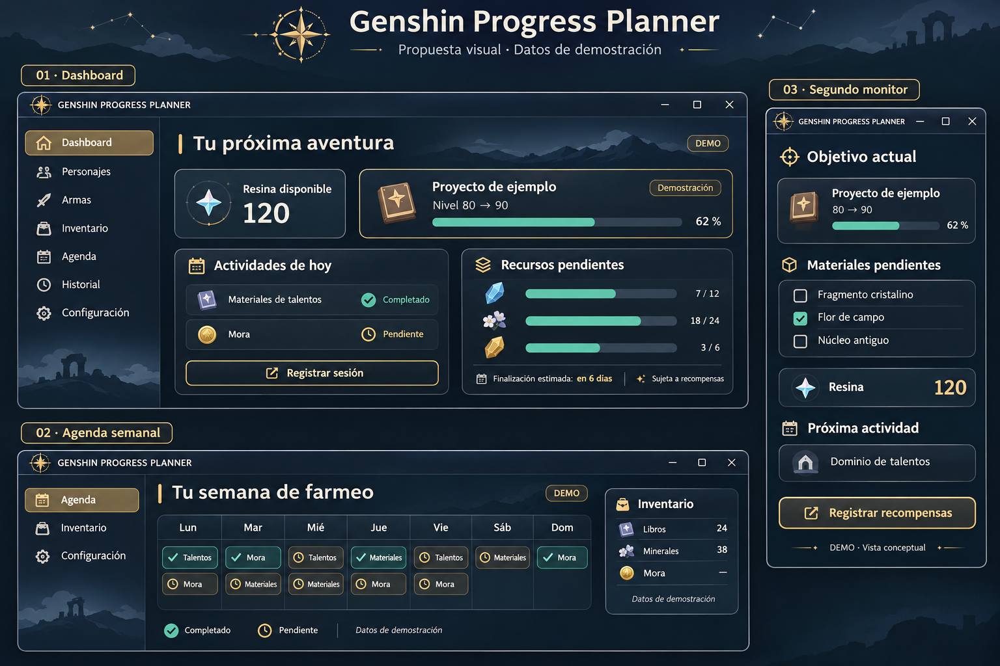

# Propuesta visual v1

**Dirección actual:** [v2 minimalista pastel y modo oscuro](PROPUESTA_V2.md), solicitada después por el usuario. La v1 se conserva solo como historial visual.

**Galería completa:** [las nueve vistas de la aplicación](TODAS_LAS_VISTAS.md).

Generada el 2026-11-15 con la herramienta integrada de generación de imágenes. Es un mockup conceptual de fases posteriores, no una captura de funcionalidades terminadas. Cantidades, nombres de materiales, fechas estimadas y calendario son demostrativos: no validan reglas del juego.

Diseño propuesto: azul nocturno, acentos dorados, indicadores verde agua, navegación lateral y paneles legibles. La implementación de Fase 1 tiene estados vacíos reales, sin introducir las cifras de este mockup.

## Prompt utilizado

Use case: ui-mockup.
Create a polished high-fidelity design presentation board for a Spanish-language native Windows Flutter app called "GENSHIN PROGRESS PLANNER". This is a prospective design, not a screenshot of a finished product. Large landscape canvas, crisp readable typography, three clearly labeled interface mockups on a subtle dark background. Main large Dashboard window on the left/top occupying most space, a weekly Agenda window underneath/right, a narrow Compact mode window to the far right. Keep all three interfaces large enough to read, carefully aligned with generous gutters. Board title "Genshin Progress Planner" subtitle "Propuesta visual · Datos de demostración".
Visual system: restrained fantasy adventure aesthetic with original compass/constellation line emblem, deep midnight navy #0D1520 background, blue-gray #141E2B panels, muted warm gold #E3C58A accents, ivory text, sage teal success indicators, 16px rounded cards, thin borders, Segoe UI-like clear sans serif. Native Windows titlebars with minimize/maximize/close, no browser chrome. No copyrighted character portraits or game logos, use original simple material glyphs, abstract landscape silhouette only as very subtle hero motif. No giant decorative illustrations, keep it a practical productivity app.
Screen 1 label "01 · Dashboard". Left navigation exactly "Dashboard", "Personajes", "Armas", "Inventario", "Agenda", "Historial", "Configuración", Dashboard selected. Header "Tu próxima aventura", small badge "DEMO". Content: compact resina summary "Resina disponible" value "120"; goal card "Proyecto de ejemplo" "Nivel 80 → 90" with progress bar and visible "Demostración"; card "Actividades de hoy" with two short rows "Materiales de talentos" and "Mora", outlined action "Registrar sesión"; lower "Recursos pendientes" showing three clean material icons and horizontal bars; discreet "Finalización estimada" and "Sujeta a recompensas". No asserted actual Genshin numerical costs or real character stats.
Screen 2 label "02 · Agenda semanal". Same design language reduced sidebar, header "Tu semana de farmeo", badge "DEMO", day column headings "Lun", "Mar", "Mié", "Jue", "Vie", "Sáb", "Dom", planned activity blocks "Talentos", "Mora", "Materiales", teal completed checkmark and gold pending indicators. Small inventory panel visible alongside calendar titled "Inventario", sample rows "Libros", "Minerales", "Mora", small text "Datos de demostración". Clear whitespace rather than dense microscopic text.
Screen 3 label "03 · Segundo monitor". Standalone tall compact native window, heading "Objetivo actual", "Proyecto de ejemplo", "80 → 90", slim progress bar, "Materiales pendientes", three checkboxes, "Resina 120", "Próxima actividad", "Dominio de talentos", button "Registrar recompensas", bottom "DEMO · Vista conceptual". Modern coherent professional UI. All text Spanish and legible. Make this a beautiful realistic product mockup board, no mobile phone, no code.
