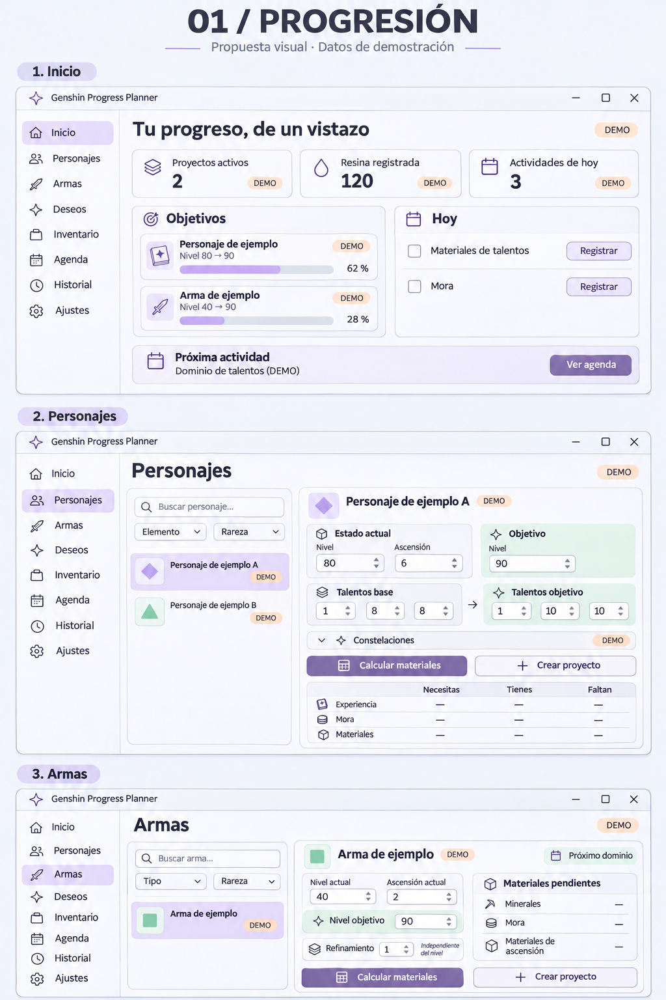
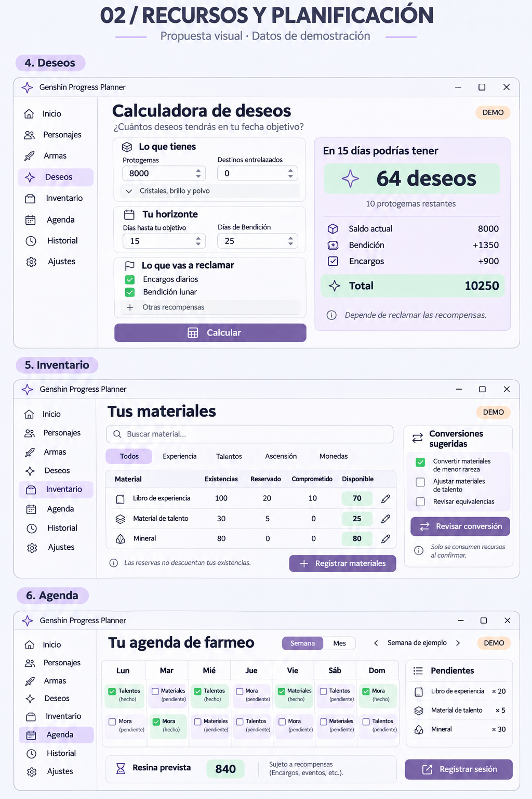
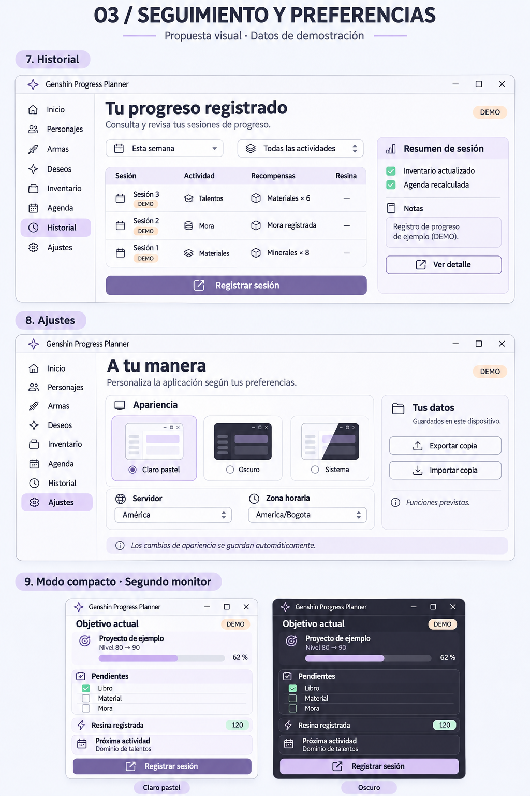

# Todas las vistas — propuesta minimalista

Generadas con la herramienta integrada de imágenes. Son mockups conceptuales, no capturas de funcionalidades implementadas. Datos, porcentajes y calendarios son demostrativos y no deben convertirse en reglas ni fuentes del motor. En particular, la agenda de muestra no valida días de dominios ni costes de resina; la resina no depende de encargos o eventos de protogemas.

## 1. Inicio, Personajes y Armas

## 2. Deseos, Inventario y Agenda

## 3. Historial, Ajustes y modo compacto

El modo oscuro se aplicará a todas las vistas; el compacto ilustra aquí ambos temas. Ajustes de servidor, zona horaria y copias de seguridad son propuestas para sus fases. La Fase 1 implementa apariencia, navegación, estados vacíos y persistencia de preferencias.

## Prompts utilizados

### Lámina 1

Use case: ui-mockup. Create a high-fidelity product design board for "Genshin Progress Planner", a native Windows Flutter app in Spanish. Match the attached pastel reference's minimalist style precisely: background #F7F8FC, white surfaces, very subtle gray dividers, muted lavender selected states and buttons #74639B, mint success #DFF2E8, pale peach badges, readable dark slate text #303446. No landscape art, no gold, no ornate fantasy decoration, no character portraits. Simple monoline icons, clean modern typography, rounded 12px cards. Native titlebars and consistent left navigation in all full screens: Inicio, Personajes, Armas, Deseos, Inventario, Agenda, Historial, Ajustes. Each screen must highlight its own active nav item. All example data explicitly marked "DEMO". Render large portrait high-resolution board with THREE separate wide desktop windows stacked vertically and clearly numbered captions, enough legible spacing and no overlaps. These are future design mockups, not current app screenshots.
Board title "01 / PROGRESIÓN", subtitle "Propuesta visual · Datos de demostración".
TOP WINDOW caption "1. Inicio". Header "Tu progreso, de un vistazo". Three small metric cards "Proyectos activos 2", "Resina registrada 120", "Actividades de hoy 3". Main left card "Objetivos" contains "Personaje de ejemplo", "Nivel 80 → 90", progress bar; second "Arma de ejemplo", "Nivel 40 → 90". Right card "Hoy" lists "Materiales de talentos" and "Mora" with unobtrusive "Registrar" buttons. Bottom small "Próxima actividad" / "Ver agenda". All metrics demo, not actual game facts.
MIDDLE WINDOW caption "2. Personajes". Header "Personajes". Search field "Buscar personaje..." and dropdown filters "Elemento", "Rareza". Left simple selection list "Personaje de ejemplo A", "Personaje de ejemplo B" with geometric pastel placeholder avatars (not silhouettes of copyrighted characters). Right form selected character: "Estado actual" with "Nivel 80" and "Ascensión 6"; "Objetivo" "Nivel 90"; "Talentos base" three compact fields "1", "8", "8" then "Talentos objetivo" "1", "10", "10"; separate small collapsed row "Constelaciones". Primary button "Calcular materiales". Compact lower summary "Necesitas", "Tienes", "Faltan" and rows "Experiencia", "Mora", "Materiales", using em-dashes rather than made-up exact costs. "Crear proyecto" secondary button.
BOTTOM WINDOW caption "3. Armas". Header "Armas". Search "Buscar arma..." filters "Tipo", "Rareza". Left selector "Arma de ejemplo". Main form "Nivel actual 40", "Ascensión actual 2", "Nivel objetivo 90". Separate row "Refinamiento" with hint "Independiente del nivel". Right summary panel "Materiales pendientes" rows "Minerales", "Mora", "Materiales de ascensión", amounts em-dashes. Footer actions "Calcular materiales", "Crear proyecto". Small availability tag "Próximo dominio". No asserted real domain dates.
Keep typography legible, interfaces plausible and implementable in Flutter, no developer code or technical framework labels.

### Lámina 2

Use case: ui-mockup. Create a high-fidelity product design board for "Genshin Progress Planner", a native Windows Flutter app in Spanish. Match the attached pastel reference's minimalist style precisely: background #F7F8FC, white surfaces, very subtle gray dividers, muted lavender selected states and buttons #74639B, mint success #DFF2E8, pale peach badges, readable dark slate text #303446. No landscape art, no gold, no ornate fantasy decoration, no character portraits. Simple monoline icons, clean modern typography, rounded 12px cards. Native titlebars and consistent left navigation in all full screens: Inicio, Personajes, Armas, Deseos, Inventario, Agenda, Historial, Ajustes. Each screen must highlight its own active nav item. All example data explicitly marked "DEMO". Render large portrait high-resolution board with THREE separate wide desktop windows stacked vertically and clearly numbered captions, enough legible spacing and no overlaps. These are future design mockups, not current app screenshots.
Board title "02 / RECURSOS Y PLANIFICACIÓN", subtitle "Propuesta visual · Datos de demostración".
TOP WINDOW caption "4. Deseos". Header "Calculadora de deseos", badge DEMO. Left form grouped into "Lo que tienes" with "Protogemas 8000", "Destinos entrelazados 0", collapsed "Cristales, brillo y polvo"; "Tu horizonte" "Días hasta tu objetivo 15", "Días de Bendición 25"; checked controls "Encargos diarios", "Bendición lunar"; secondary link "+ Otras recompensas"; button "Calcular". Right lavender result "En 15 días podrías tener" large "64 deseos", "10 protogemas restantes", breakdown "Saldo actual 8000", "Bendición +1350", "Encargos +900", "Total 10250". Small "Depende de reclamar las recompensas".
MIDDLE WINDOW caption "5. Inventario". Header "Tus materiales". Search "Buscar material..." categories as tabs "Todos", "Experiencia", "Talentos", "Ascensión", "Monedas". Main clean table labeled "Material", "Existencias", "Reservado", "Comprometido", "Disponible". Example rows deliberately generic "Libro de experiencia" amounts 100,20,10,70; "Material de talento" 30,5,0,25; "Mineral" 80,0,0,80; all demo. Small pencil icons to edit each row, action "Registrar materiales". Side narrow card "Conversiones sugeridas" with "Revisar conversión" and small note "Solo se consumen recursos al confirmar". Footer note "Las reservas no descuentan tus existencias." Avoid implied auto-consumption.
BOTTOM WINDOW caption "6. Agenda". Header "Tu agenda de farmeo". Toolbar "Semana" selected, "Mes", date label "Semana de ejemplo", badge DEMO. Main 7-column calendar labeled "Lun", "Mar", "Mié", "Jue", "Vie", "Sáb", "Dom" with minimal pastel activity blocks "Talentos", "Mora", "Materiales" scattered, clear completed vs pending statuses. Next to calendar a compact visible inventory panel labeled "Pendientes" with generic material rows. Beneath a strip "Resina prevista" and "Sujeto a recompensas"; right bottom button "Registrar sesión". Domain schedule entirely demonstrative, no real exact dates or guaranteed finish. All content Spanish, large enough to read.

### Lámina 3

Use case: ui-mockup. Create a high-fidelity product design board for "Genshin Progress Planner", a native Windows Flutter app in Spanish. Match the attached pastel reference's minimalist style precisely: background #F7F8FC, white surfaces, very subtle gray dividers, muted lavender selected states and buttons #74639B, mint success #DFF2E8, pale peach badges, readable dark slate text #303446. No landscape art, no gold, no ornate fantasy decoration, no character portraits. Simple monoline icons, clean modern typography, rounded 12px cards. Native titlebars and consistent left navigation in all full screens: Inicio, Personajes, Armas, Deseos, Inventario, Agenda, Historial, Ajustes. Each screen must highlight its own active nav item. All example data explicitly marked "DEMO". Render large portrait high-resolution board with THREE separate wide desktop windows stacked vertically and clearly numbered captions, enough legible spacing and no overlaps. These are future design mockups, not current app screenshots.
Board title "03 / SEGUIMIENTO Y PREFERENCIAS", subtitle "Propuesta visual · Datos de demostración".
TOP WINDOW caption "7. Historial". Header "Tu progreso registrado". Toolbar filter "Esta semana", "Todas las actividades". Clean table columns "Sesión", "Actividad", "Recompensas", "Resina", rows with generic demo labels "Sesión 3", "Talentos", "Materiales × 6", "—"; "Sesión 2", "Mora", "Mora registrada", "—"; "Sesión 1", "Materiales", "Minerales × 8", "—". Side detail card "Resumen de sesión", small "Inventario actualizado", "Agenda recalculada", "Notas", and outline action "Ver detalle". No auto-delete or destructive button. Include "Registrar sesión" primary action.
MIDDLE WINDOW caption "8. Ajustes". Header "A tu manera". Main card "Apariencia" with three visual sample tiles each with small mini window preview: "Claro pastel", "Oscuro", "Sistema", light selected lavender outline. Secondary row "Servidor" dropdown "América"; "Zona horaria" dropdown "America/Bogota". Card "Tus datos" description "Guardados en este dispositivo" with outlined "Exportar copia" and "Importar copia"; discreet note "Funciones previstas". These settings other than appearance are prospective. No cloud account, no sign-in. Footer "Los cambios de apariencia se guardan automáticamente."
BOTTOM area caption "9. Modo compacto · Segundo monitor". Show TWO narrow compact native app windows side by side with captions "Claro pastel" and "Oscuro"; both same content, NO full sidebar, very space efficient. Each header "Objetivo actual", "Proyecto de ejemplo", "Nivel 80 → 90", thin progress bar, "Pendientes" three material checkboxes using generic "Libro", "Material", "Mora"; small row "Resina registrada 120"; "Próxima actividad" "Dominio de talentos"; bottom primary "Registrar sesión". One compact window light white pastel; other dark charcoal violet #191A24 background, #222330 panels, lavender #C8B7EA accents, soft off-white text and muted mint, no pure white backgrounds. Badge DEMO on both. No device mockup or game scene in background. Clean readable high fidelity UI.
